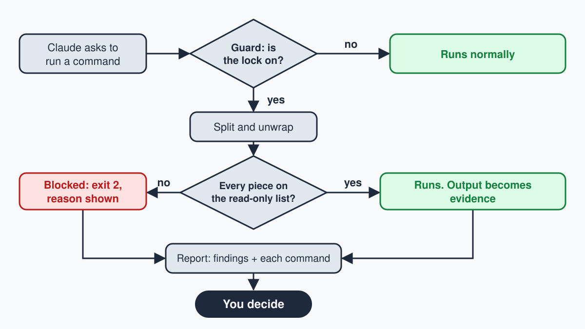

# what-claude-really-finds

A read-only audit of your Mac where every finding shows the command behind it, plus a guard that only lets read-only commands run while the audit is on.

This is a small tool that lets Claude Code look around your Mac and report what it sees, without being able to change anything. On my Mac it found 253 GB of caches that rebuild themselves and 10 desktop apps carrying browser engines that Electron itself no longer patches, and each line comes with the command so you can re-run it yourself. The guard matters because "I told the AI not to touch anything" is a promise, and a promise is not a lock.



## What my Mac audit actually found

One run on my own MacBook (1.8 TB disk, 265 GB free) on 3 November 2026: 332 read-only commands, 7.3 minutes. No photos of anyone's face. No servers in another country. Just this:

| Finding | What the command showed | Command | Safe to clear? |
|---|---|---|---|
| Python package cache | 212.9 GB in one folder | `du -skx ~/.cache/uv` | safe, it re-downloads |
| Everything that rebuilds itself | 253 GB across 9 caches (uv, npm, Homebrew, Playwright, Gradle, pip, Puppeteer, Xcode, Cargo) | `du -skx <each path>` | safe |
| Messages attachments | 67.0 GB of things people sent me | `du -skx ~/Library/Messages/Attachments` | review, it is my data |
| Local AI models | 31.7 GB Hugging Face + 7.8 GB Ollama | `du -skx ~/.cache/huggingface ~/.ollama/models` | review, slow to re-download |
| Agent chat history | 9.1 GB Claude Code + 5.3 GB Codex sessions | `du -skx ~/.claude/projects ~/.codex` | review |
| Spare copies of Chromium | 15 Playwright browser builds + 2 Puppeteer, 7.0 GB together | `ls ~/Library/Caches/ms-playwright` | safe, test tools re-install them |
| Old browser engines inside desktop apps | 10 of the 16 Electron apps I could read run an Electron major that Electron itself no longer patches. The oldest embeds Chrome 102, a 2022 engine. | `grep -aoE 'Chrome/[0-9.]+ Electron/[0-9.]+' "<App>.app/Contents/Frameworks/Electron Framework.framework/Electron Framework"` | update the app, never delete its files |
| Startup items | 50 launch items on disk, 45 non-Apple jobs loaded | `ls ~/Library/LaunchAgents` and `launchctl list` | review each one; listed, not judged |

Two things surprised me. First, one app's framework label claimed version 1.4.26 while the binary inside said Electron 44.4.3, so the audit now reads the binary, not the label. Second, the scariest real finding was boring: old Chromium engines I had never thought about, sitting inside apps I use every day.

What I left out on purpose: my security settings, my app list in full, and anything under my home folder's personal files. An audit you publish should not become a map for someone else. The supported Electron versions (the latest three majors, 43 to 45 on the day of this run) come from [releases.electronjs.org](https://releases.electronjs.org).

## Why a guard, not a promise

Think of a library. One way to keep a visitor from damaging the books is to hand them a list of banned books and hope the list is complete. The other way is to give them a visitor pass that opens only the reading room. The first is a denylist: block what you thought of. The second is an allowlist: allow only what you named, and everything else stays shut.

Most safety hooks (small scripts that Claude Code runs before each action and that can say no) use the denylist idea. They block `rm -rf` and hope nobody invents a different way to delete. This guard uses the visitor pass. While an audit is running, a command only goes through if it is on a short read-only list.

How it decides, in order:

1. **Parse.** Split the command on `;`, `&&`, `||`, pipes and new lines, so `ls; rm -rf ~` is two pieces, not one.
2. **Unwrap.** Peel off `sudo`, `env`, `time`, full paths like `/bin/rm`, and look inside `bash -c '...'` and every `$(...)`, even one hidden in double quotes, because the shell still runs those. Text inside single quotes is treated as data, not as a command.
3. **Allowlist.** Every piece must be a command on the read-only list, with no flag that can write (for example `find -delete` or `sed -i`). Output redirection to a file is refused.
4. **Fail closed.** If the guard cannot read or understand the input, it blocks instead of guessing.
5. **Exit code 2.** A block is the exit code 2 (the signal Claude Code treats as "stop"), with a message that names the rule and a read-only alternative.

The guard sleeps until a lock file exists, and the lock expires on its own. There is no bypass variable. Only a human in a normal Terminal window can end it early, because the agent is blocked from `rm`, from writing files, and from touching the lock path itself.

It also blocks the Write and Edit tools outright, blocks reading the contents of secret places (`~/.ssh`, `~/.aws`, keychains, `.env` files; listing them is fine), and blocks almost every other tool, such as web fetches. Only the to-do list tools stay open.

### Examples from the test suite

| Command | Result | Why |
|---|---|---|
| `ls; rm -rf ~` | blocked | Split on `;`, and `rm` is not on the list |
| `sudo rm -rf /` | blocked | `sudo` is unwrapped, then `rm` fails |
| `bash -c 'rm -rf ~'` | blocked | The guard looks inside the quotes of `bash -c` |
| `find ~ -name '*.log' -delete` | blocked | `find` is allowed, but `-delete` is not |
| `echo hi > ~/notes.txt` | blocked | Redirecting output to a file writes it |
| `cat ~/.ssh/id_ed25519` | blocked | Secret location |
| `grep "rm -rf" notes.txt` | allowed | The words are inside quotes, so they are data |
| `du -sh ~/Library/Caches/* 2>/dev/null \| sort -rh \| head -20` | allowed | Every piece is read-only, and sending errors to `/dev/null` writes nothing |

The test file `tests/test_guard.py` fires real hook payloads at the guard and checks the exit code. It has 74 commands that must be blocked, 40 that must be allowed, 6 tool checks and 3 lock checks, 123 in total.

## What an audit can't tell you

- It cannot see what an app sent over the network in the past. macOS keeps no such log by default, so a claim like "17,000 photos went to a server" needs a network capture made at the time.
- It cannot read your iPhone. A phone shows up only through a backup or a dedicated tool, and iOS apps are sandboxed from each other's files.
- It cannot recover deleted files. Without a backup copy, they are gone.
- It does not decide whether a startup item is malicious. It lists each one with what it runs, so you can look them up.

## How to check a viral "Claude found..." claim

Most of the viral ones show no output at all, and I will not name any of them. Use these five steps on any post:

1. **Ask for the output.** A real audit has a terminal screenshot with the command visible.
2. **Ask for the mechanism.** What file, log or API held the evidence? Does that log even exist on that system?
3. **Run it yourself.** If the prompt is not in the post, the result cannot be checked.
4. **Check the count.** An exact huge number with no listing is a storytelling device, not data.
5. **Ask why it needed an AI.** Most real findings come from one built-in command, such as `du`, `launchctl list` or `fdesetup status`.

## Quick start

```bash
git clone https://github.com/wilsonwu-ai/what-claude-really-finds && cd what-claude-really-finds
python3 tests/test_guard.py
python3 install.py            # shows what would change, changes nothing
python3 install.py --apply    # backs up settings.json, then adds the hook and the skill
```

Restart Claude Code after `--apply`, start the lock with `python3 guard/lock.py on`, then ask Claude to run the audit skill. Remove the hook any time with `python3 install.py --remove`.

No Claude? Just run `python3 audit/mac_audit.py --quick`. It prints each finding with its command and writes nothing unless you pass `--out`.

## Standing on shoulders

I took ideas from these projects. No code was copied.

- [Dicklesworthstone/destructive_command_guard](https://github.com/Dicklesworthstone/destructive_command_guard): normalise a command before judging it, and treat quoted text as data.
- [kenryu42/cc-safety-net](https://github.com/kenryu42/cc-safety-net): look inside wrapped commands such as `bash -c`, and guard secret reads in the file tools too.
- [anthropics/sandbox-runtime](https://github.com/anthropics/sandbox-runtime): allowlist-only writes, protected config paths, and enforcement by the operating system.
- [yurukusa/cc-safe-setup](https://github.com/yurukusa/cc-safe-setup): exit code 2 with a message on stderr is the reliable way to block, and tests should use real shell shapes.
- [alexknowshtml/claude-code-safety-hooks](https://github.com/alexknowshtml/claude-code-safety-hooks): a block message should say why it blocked.
- [ashishmerani/claude-code-safety-hooks](https://github.com/ashishmerani/claude-code-safety-hooks): be honest that a hook is a floor, not a wall.

## Limits

A hook is a floor, not a sandbox. It checks what the agent asks to run, not what the operating system lets it do. For enforcement at the kernel level, run the agent under macOS `sandbox-exec` or anthropics/sandbox-runtime as well. This tool is for macOS only.

## License

MIT. See [LICENSE](LICENSE).
